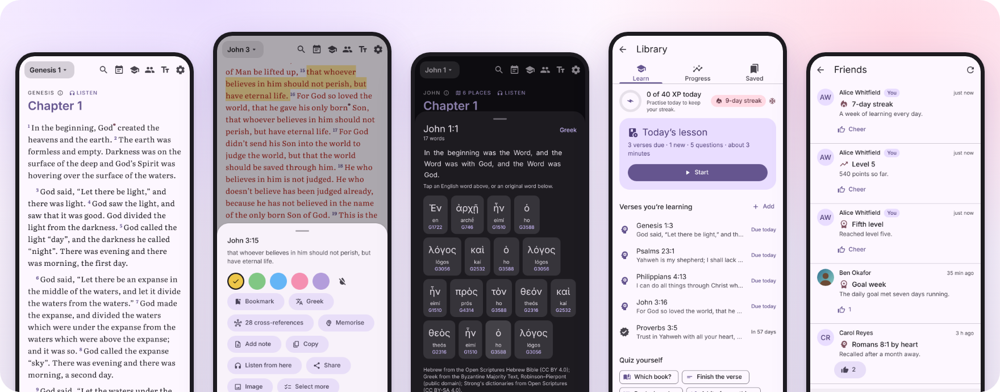
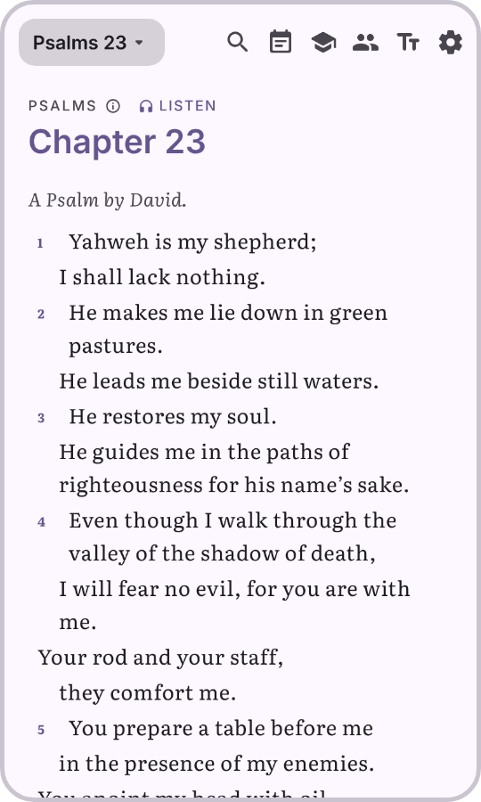
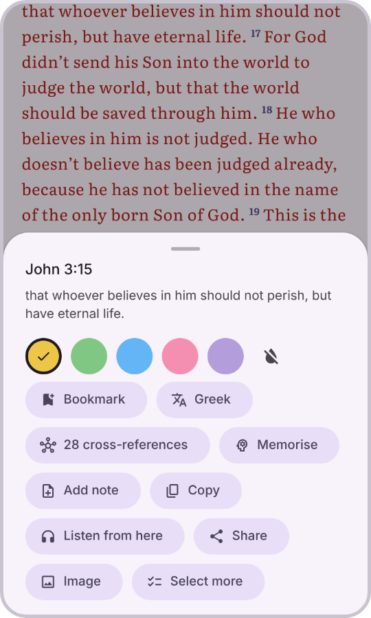
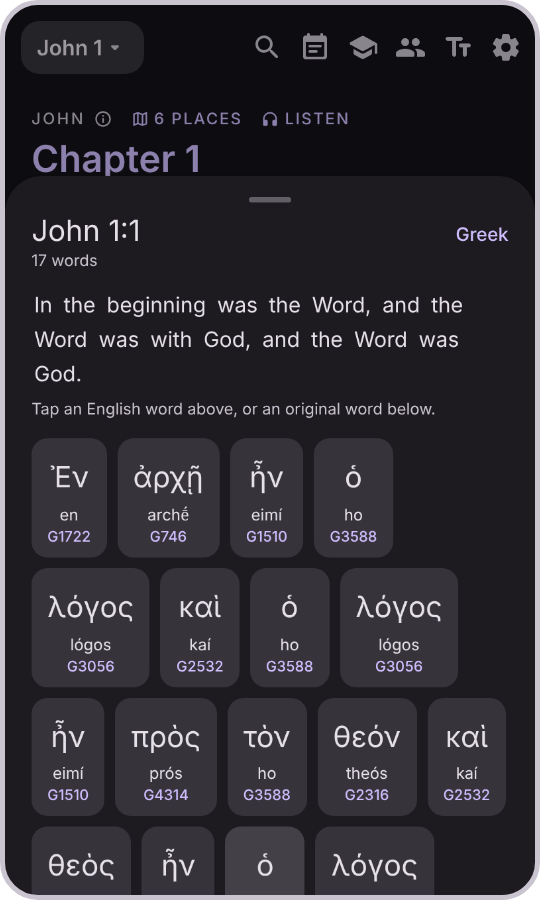
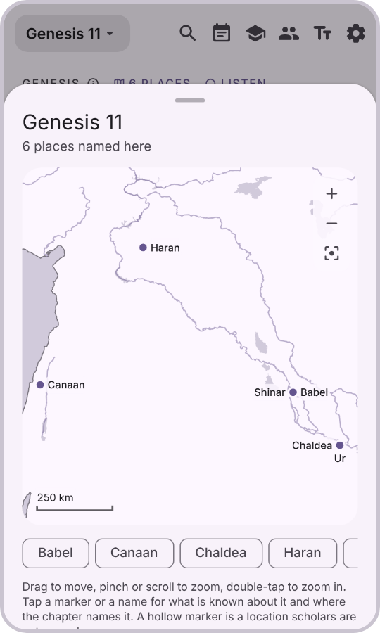
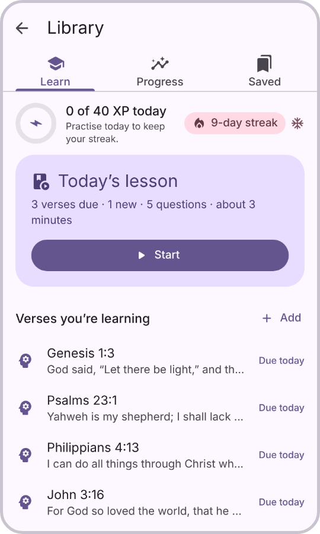
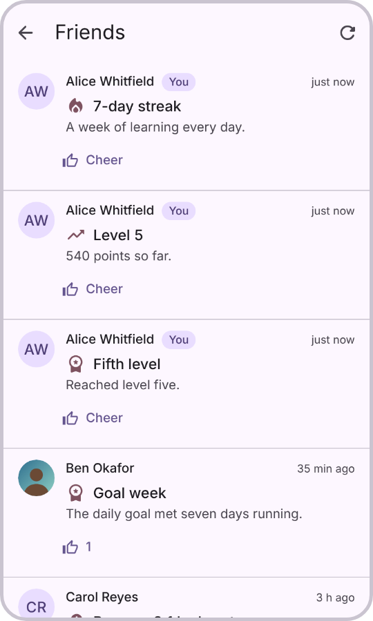
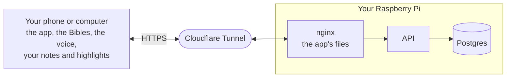

<div align="center">


# OpenWord

**A Bible to read, hear and learn by heart.**<br>
Free, open source, and yours to host.

[**Open the app →**](https://openword.faith)
&nbsp;·&nbsp; [Host your own](#host-your-own)
&nbsp;·&nbsp; [Everything it does](docs/features.md)

<br>


[](https://github.com/tahuffman1s/OpenWord/actions/workflows/ci.yml)


<br>



</div>

## Start in a minute

1. **Open [openword.faith](https://openword.faith)** on your phone or computer. There is nothing to sign up for.
2. **Add it to your home screen**, so it opens like any other app and works with no connection.

   | iPhone and iPad | Android | Computer |
   |---|---|---|
   | In Safari, tap **Share**, then **Add to Home Screen** | In Chrome, tap **⋮**, then **Add to Home screen** | In Chrome or Edge, click the **install** icon in the address bar |

3. **Read.** A short walkthrough shows you round the first time. *Settings → Install the app* has these steps again, for whichever browser you are in.

## What you can do

<table>
<tr>
<td width="33%" align="center" valign="top">
<br><br>
<b>Read it like a printed Bible</b><br>
Paragraphs, poetry, headings and footnotes as the translation sets them. Type <code>jn 3:16</code> or <code>ps 23</code> to go anywhere.
</td>
<td width="33%" align="center" valign="top">
<br><br>
<b>Make it yours</b><br>
Tap a verse to highlight it in five colours, bookmark it, write a note, copy it, or share it as a picture.
</td>
<td width="33%" align="center" valign="top">
<br><br>
<b>See the Hebrew and Greek</b><br>
Every word behind a verse, how it is said and what it means, and every other place it appears.
</td>
</tr>
<tr>
<td align="center" valign="top">
<br>
<br><br>
<b>Find the places</b><br>
A map of what each chapter names, and three hundred thousand cross-references a tap away.
</td>
<td align="center" valign="top">
<br>
<br><br>
<b>Learn verses by heart</b><br>
A minute a day. Verses come back just before you would forget them, with streaks, levels and twelve badges.
</td>
<td align="center" valign="top">
<br>
<br><br>
<b>Keep going together</b><br>
Add friends, keep a streak with each of them, and cheer what they earn. An account is optional.
</td>
</tr>
</table>

| Also | |
|---|---|
| **Listen** | A natural voice reads the chapter aloud, on your device, with the screen off. Headphones and car buttons pause it and step it by verse. |
| **Plans** | Six reading plans, from the Gospels in 30 days to the whole Bible in a year. A missed day waits for you. |
| **Quizzes** | Rounds of ten: which book, finish the verse, books in order. |
| **Compare** | Two translations side by side, verse by verse. |
| **Search** | The whole Bible, a testament, or one book. |
| **Your own translation** | Bring an EPUB of a Bible and it reads like the three that ship. |
| **Your look** | Any colour for the theme, light or dark with your system, and the text size and typeface you like. |
| **Reminders** | A nudge at the time you choose, and one before a streak you share is about to end. |

[**The full list, in detail →**](docs/features.md)

## Private by design

- **Your reading stays on your device.** Highlights, notes, your place and what you are learning are kept in your browser and never sent anywhere.
- **It works offline.** The app, three public-domain translations, the maps, the cross-references and the Hebrew and Greek are all kept once you have opened it.
- **A translation you import is never uploaded.** It is converted on your device and stays there.
- **No tracking, no ads, no telemetry.** An account exists only for friends, reminders and a backup you ask for.

## Host your own

One command puts OpenWord on a Raspberry Pi, or any 64-bit Linux machine, at your own address:

```bash
curl -fsSL https://raw.githubusercontent.com/tahuffman1s/OpenWord/main/deploy/install.sh | bash
```

It installs Docker if it is missing, asks for a Cloudflare tunnel token and your address, builds everything and starts it. With no token it serves on your home network instead.

**You need** a Raspberry Pi 4 with 2 GB or more (or any 64-bit Linux box), about 4 GB of disk, and for a public address a domain on Cloudflare's free plan. No port forwarding.

**Afterwards**, each of these is one command:

| Command | What it does |
|---|---|
| `openword update` | Get the latest version |
| `openword status` | See that everything is up |
| `openword logs` | See what it is saying |
| `openword backup` | Save the accounts database |



Only accounts, friends, streaks and the backups you ask for ever reach the server. The whole stack idles at about 50 MB of memory.

[**The hosting guide →**](deploy/README.md) covers Cloudflare step by step, home-network mode, updating, backups and troubleshooting.

## For developers

| Directory | What is in it |
|---|---|
| [`pwa/`](pwa) | The app: TypeScript, Preact and Vite, with a Material 3 kit of its own |
| [`server/`](server) | The API: Go over Postgres, for accounts, friends, streaks, reminders and backups |
| [`deploy/`](deploy) | Docker Compose, nginx, the Cloudflare Tunnel and the installer |
| [`assets/`](assets) | The translations, maps, cross-references, originals and fonts that ship |
| [`docs/`](docs) | The guides below |

```bash
cd pwa && npm ci && npm run dev      # the app, at localhost:5173
npm test && npm run typecheck        # tests run against the data that ships
cd ../server && go test ./...        # the API
```

OpenWord ships as two Docker images, `openword-web` and `openword-api`. Every push is built into them, started as a whole stack with Postgres, and tested over HTTP and in a browser; what passes on `main` is published to the GitHub Container Registry for `arm64` and `amd64`. To run the same checks against a stack of your own:

```bash
deploy/smoke.sh http://localhost:8080                  # the stack, from outside
node pwa/scripts/image-smoke.mjs http://localhost:8080 # the app, in a browser
```

### Documentation

| Guide | What is in it |
|---|---|
| [Everything it does](docs/features.md) | Every feature, in detail |
| [Hosting guide](deploy/README.md) | Running your own, from the one-liner to restoring a backup |
| [Translations](docs/translations.md) | The three that ship, importing an EPUB, and how the converter reads one |
| [The `.bib` format](docs/bib-format.md) | The single-file format a translation is kept in |
| [Study layers](docs/study-layers.md) | Book introductions, the Hebrew and Greek, cross-references and maps |
| [API](docs/api.md) | The server's contract |
| [The voice](pwa/src/speech/README.md) | How speech is made in the browser |
| [Changelog](CHANGELOG.md) | What changed, release by release |

## Licence and credits

The code is [MIT](LICENSE), the `.bib` format included.

OpenWord stands on open work: the [World English Bible](https://ebible.org/web/) and [Berean Standard Bible](https://berean.bible/), the [Open Scriptures](https://github.com/openscriptures) Hebrew Bible and Strong's dictionaries, the Byzantine Majority Text, [CrossReferences.org](https://crossreferences.org), [OpenBible.info](https://www.openbible.info/geo/) geocoding, Natural Earth, Tyndale's Open Study Notes, [KittenTTS](https://github.com/KittenML/KittenTTS), ONNX Runtime, eSpeak NG, and the Literata and Noto typefaces.

[**Every licence and attribution →**](docs/licences.md)
